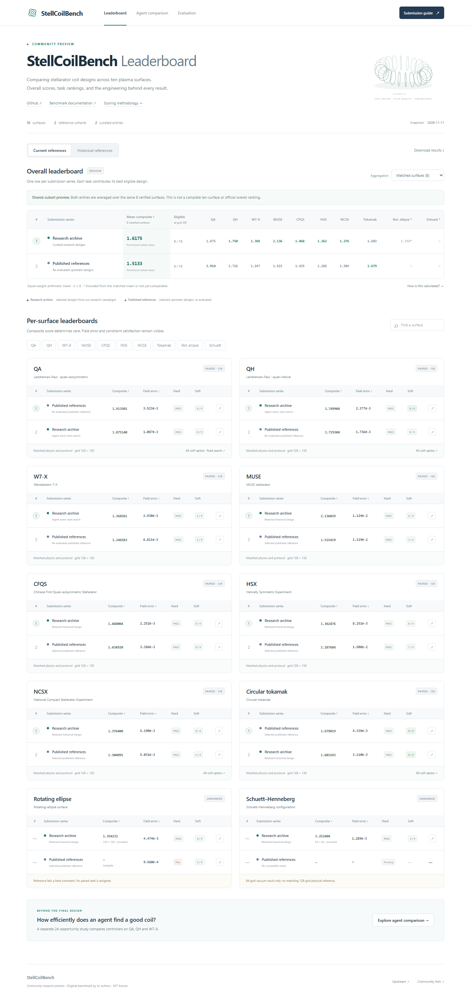

# StellCoilBench community leaderboard preview

An English community leaderboard covering **all ten surfaces** and **two reference cohorts**. The overall table has one row per submission series and one column per task; ten separate task tables rank the same entries within each surface. The three-surface agent comparison remains a separate page.

Open locally from this directory:

```sh
python -m http.server 8765 --bind 127.0.0.1
```

Visit http://127.0.0.1:8765. There are no package dependencies, external fonts, API keys, analytics, or remote model calls. The page requires HTTP to load its packaged JSON; opening `index.html` as `file://` is not supported.



## Included

- Ten surfaces in each of the current and historical **reference** cohorts; retained designs may originate from a historical recipe when paired physics is compatible. These are not two isolated original-agent campaigns.
- An overall mean-composite table, with complete task columns and eligibility coverage. One row is one submission series; this snapshot contains two curated design archives, not two equal-budget autonomous agents.
- Ten per-surface tables sorted by eligible composite score, including field error, hard checks, soft-target counts and evidence links. All-soft alternatives remain separately identified.
- Strict paired-comparison checks: complete hard PASS, matching protocol hash, grid, cohort and surface. Missing/incompatible references never become a zero-score win.
- 48 curated design records and 33 sanitized scientific evidence summaries. Original report hashes remain attached. This is a curated research snapshot, not exhaustive ranking of every public geometry.
- Ten manuscript arms from a completed 24-opportunity agent experiment on QA/QH/W7-X, with declared prior-information asymmetry. Historical design results and controlled-search outcomes stay separate.
- Local JSON manifest structure validation and an example manifest. This does **not** upload artifacts, run the scientific evaluator, check actual file content hashes, or submit to a leaderboard. Placeholder hashes in the example are not real scientific provenance.
- An English-only interface, search, cohort switching, aggregate mode selection, candidate details, data download, 6/12/24-opportunity curves and mobile layouts.

## Overall aggregation

The proposed cross-surface aggregate is an equal-weight arithmetic mean of the unmodified per-design official composite scores. It is a preview convention, not an official upstream overall metric.

- **Matched surfaces:** the same fixed, predeclared subset is required for both entries: current references use QA, QH, W7-X, MUSE, CFQS, HSX, NCSX and tokamak (8); historical references additionally include Schuett (9). Missing a required pair withholds both means; the denominator never shrinks independently per row.
- **All 10 surfaces:** a full-suite mean and rank require all ten complete, compatible, hard-passing pairs. The current snapshot is incomplete, so neither entry receives a full-suite average or rank.
- Missing scores are not zeros. Hard-failed references are not a basis for a positive-versus-zero win. Exact numeric ties share a rank; small score differences do not imply statistical significance.
- The overall table reports the selected best-score design from each archive. An alternative all-soft design is never mixed with that design's score, field error or constraint counts.

`aggregate-model.js` computes both the overall and per-surface views from the packaged evidence. Its tests cover missing entries, duplicate identities, mismatched protocols/physics, shared denominators, hard failures, ties and a future complete ten-task fixture.

## Interface references

The entry-row, aggregate-plus-task-column structure was informed by [MTEB](https://huggingface.co/spaces/mteb/leaderboard), with separate evaluation tracks and evidence conventions observed in [SWE-bench](https://www.swebench.com/) and [HELM](https://crfm.stanford.edu/helm/lite/latest/). Their scores and ranking formulas are not reused.

## Scientific scope

The evaluator and thresholds remain those of upstream StellCoilBench. The snapshot combines complete paired 64/128 evaluations and selected independent fresh128 confirmations. Grids and exact protocol hashes are exposed per record. Current Schuett lacks a matched physical configuration; rotating-ellipse references are hard-ineligible. Their rows remain visible without a win claim.

The QA all-soft candidate comes from **fixed search**, not our agent, and has a different evaluation protocol from the current design reference. It is shown with its origin and without a cross-protocol score delta. Latest warm-start designs are not copied into historical-reference comparisons without matching paired evidence.

The 24-opportunity experiment is one controller trajectory. The official-policy adapter has additional complete-baseline advice. Equal solver caps do not imply equal actual runtime, tokens, model requests, or end-to-end cost. ScienceEvolve is a fixed-runtime substitution condition, not a test of unrestricted workflow evolution.

These are research re-evaluations, not accepted official leaderboard submissions. The original upstream leaderboard is https://stellcoilbench.readthedocs.io/en/latest/leaderboard/surface_specific.html. Public intake, hosting and a shared evaluation protocol remain proposals for collaboration with the original author.

## Checks

```sh
node --test
```

The model tests guard scientific compatibility, missing-result handling, evidence URL restrictions and manifest validation. `data/snapshot-manifest.json` records SHA256 of the packaged datasets/evidence for independent inspection.

## Attribution

Based on [StellCoilBench](https://github.com/akaptano/stellcoilbench) by its original authors, under the repository's MIT license. This community UI and curated snapshot are additional work in a fork; they do not imply author endorsement or transfer of official maintenance.
